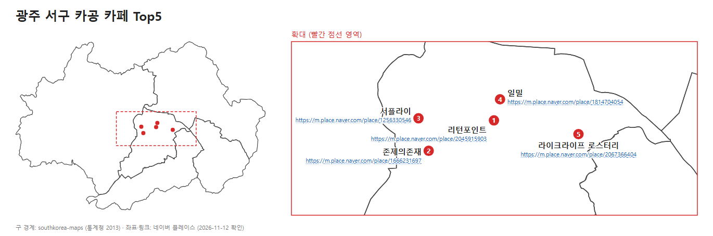

# 광주 서구 공부하기 좋은 카페 (프랜차이즈 제외)

- 지역: 전남광주통합특별시 서구
- 확인 날짜: 2026-11-12
- 출처: 네이버 블로그 검색, 네이버 플레이스(방문자 리뷰), 카카오맵(별점·후기)

---

## 1. 최종 Top 5

### 선정 기준
- 별점: 카카오맵 별점 (네이버 플레이스는 별점을 대부분 비공개라 리뷰 수만 사용)
- 리뷰 수: 카카오맵 후기 수 + 네이버 방문자 리뷰 수
- 방법: 아래 3개 항목 각각 순위를 매기고 합산, 합이 작은 순
  1. 카카오 별점
  2. 카카오 후기(별점 참여) 수
  3. 네이버 방문자 리뷰 수
- 제외: 카카오·네이버 중 한쪽 데이터가 없는 곳, 별점 없음 또는 4.0 미만
- 동점 처리: 카카오 별점 참여 수가 많은 쪽 우선

| 순위 | 카페 | 주소 | 카카오 별점 (참여) | 네이버 방문자 리뷰 | 순위 합 | 네이버 플레이스 (사진 포함) |
|---|---|---|---|---|---|---|
| 1 | 리턴포인트 | 서구 상무대로 895 1층 | 4.9 (8명) | 688 | 8 | [링크](https://m.place.naver.com/place/2045915903) |
| 2 | 존제의존재 | 서구 상무누리로 5 1층 | 4.0 (31명) | 355 | 10.5 | [링크](https://m.place.naver.com/place/1666231697) |
| 3 | 서플라이 | 서구 상무자유로 32 1층 | 4.0 (13명) | 456 | 11 | [링크](https://m.place.naver.com/place/1256330546) |
| 4 | 일밀 | 서구 상무오월로19번길 6 1층 | 4.6 (9명) | 283 | 12 | [링크](https://m.place.naver.com/place/1814704054) |
| 5 | 라이크라이프 로스터리 | 서구 화정로 256-1 2층 | 4.7 (13명) / 네이버 4.92 (23명) | 57 | 12.5 | [링크](https://m.place.naver.com/place/2067366404) |

- 카페 사진은 저작권 때문에 파일로 넣지 않고 네이버 플레이스 링크로 대신함

- 6위: 데일리603 (순위 합 12.5, 별점 5.0이지만 참여 2명이라 동점에서 밀림)
- 별점 참여 인원이 2~31명으로 적어서 순위는 참고용

### 위치 지도

- 광주 구 경계선만 표시 (구 이름·색 구분 없음), 빨간 점선 = 확대 영역
- 확대 지도의 번호 점 옆에 카페 이름 + 네이버 플레이스 링크 표시
- 5곳 모두 서구 북쪽(상무지구~화정동)에 모여 있음
- 구 경계: southkorea-maps (통계청 2013), 현재 경계와 조금 다를 수 있음
- 좌표: 네이버 플레이스 (2026-11-12 확인)
- 원본: [gwangju_cafe_top5.svg](gwangju_cafe_top5.svg) (SVG에서는 링크 클릭 가능)

---

## 2. 전체 후보 12곳 (블로그 후기 기준)

네이버 블로그에서 "공부·카공·조용함" 언급이 있는 개인 카페만 모음.

| # | 카페 | 위치 | 포인트 | 카카오 별점 (참여) | 카카오 블로그 리뷰 | 네이버 방문자 리뷰 |
|---|---|---|---|---|---|---|
| 1 | 존제의존재 | 상무누리로 5 | 조용함 언급 최다, 콘센트·주차, 09~21시, "집중하기 좋아요" 185명 | 4.0 (31) | 326 | 355 |
| 2 | 고이오 | 운천로184번길 40 (쌍촌동) | 아늑함, 콘센트, 저렴 | 없음 (0) | 4 | 44 |
| 3 | 카페딜라이트 | 상무대로 867 1~2층 | 작업하기 좋은 테이블, 신상 | 5.0 (4) | 12 | 못 찾음 |
| 4 | 라이크라이프 로스터리 | 화정로 256-1 2층 | 카공 손님 많음, 조용 | 4.7 (13) | 192 | 57 |
| 5 | 까페보니떼 풍암점 | 풍암순환로128번길 95 2층 | 책 있는 카페, "매장이 넓어요" 키워드 | 4.5 (2) | 4 | 118 |
| 6 | 만호동 | 금호만호길 45-1 2층 | 한옥, 조용 | 4.4 (7) | 54 | 못 찾음 |
| 7 | 리턴포인트 | 상무대로 895 | 노트북 하기 좋다는 후기 | 4.9 (8) | 137 | 688 |
| 8 | 데일리603 | 화정로253번길 10 | 차분, 아기자기 | 5.0 (2) | 9 | 183 |
| 9 | 일밀 | 상무오월로19번길 6 | 골목 안 조용한 동네 카페 | 4.6 (9) | 98 | 283 |
| 10 | 앤드커피 | 구성로93번길 2 (양동) | 조용, 넓음(블로그), 주차 | 3.0 (1) | 2 | 2 |
| 11 | 카페미민 | 풍금로3번길 6 (풍암동) | 자리마다 콘센트 | 없음 (0) | 19 | 17 |
| 12 | 서플라이 | 상무자유로 32 | 대형, 층고 높음, 단체 손님 많음 | 4.0 (13) | 130 | 456 |

### 공간이 넓다는 근거가 있는 곳
- 서플라이: 리뷰에 "내부가 훨씬 넓고 층고가 높음", 대형 카페
- 까페보니떼: 네이버 리뷰 키워드 "매장이 넓어요"
- 앤드커피: 블로그에 "넓다" 언급 (리뷰 적음)

### 제외한 곳
- 프랜차이즈: 스타벅스, 투썸플레이스, 할리스, 이디야, 메가커피
- 체인 라운지형: 카공족
- 만화카페: 머든
- 스터디카페: 공부인, 지니어스, 스터디봄 등

---

## 3. 참고
- 카카오맵에 "광주 서구 공부하기 좋은 카페"로 검색하면 결과가 0건이라 네이버 블로그로 후보를 모음
- 블로그 검색어: "광주 서구 공부하기 좋은 카페 카공", "광주 서구 조용한 카페 카공 콘센트 개인카페"
- 앤드커피(2024), 카페미민(2024)은 블로그 후기가 오래됨
- 영업시간·휴무는 방문 전 지도 앱에서 다시 확인 필요
