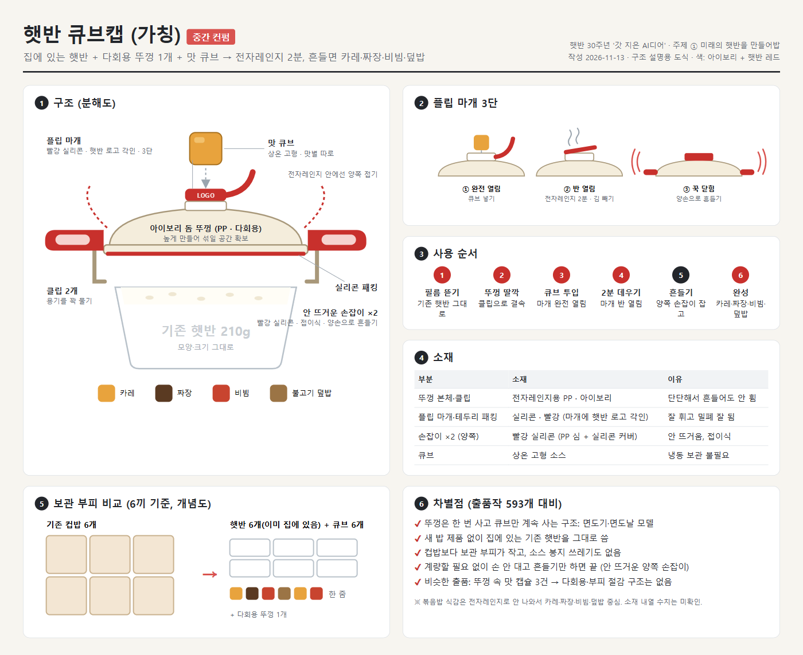

# 햇반출품1: 햇반 큐브캡 (가칭)

- 작성일: 2026-11-13
- 공모전: 햇반 30주년 '갓 지은 AI디어' (접수 마감 2026-11-13 23:59)
- 주제: ① 미래의 햇반을 만들어밥
- 중간 컨펌 이미지: `햇반큐브캡_중간컨펌.png` (원본 `햇반큐브캡_중간컨펌.html`, 같은 폴더)

---

## 1. 처음 아이디어 (원안)

- 햇반의 원래 모양·크기는 그대로 유지
- 햇반 크기에 맞춘 **다회용 뚜껑**을 따로 하나 제작·판매
- 뚜껑 가운데에 **돌려서 여는 작은 원형 뚜껑**을 하나 더 만듦
- 그 원형 뚜껑 크기에 맞는 **동그란 큐브**가 있음 (맛별로 따로 판매)
- 큐브 넣고 → 뚜껑 덮고 → 전자레인지에 돌리고 → 흔들면 큐브 맛에 따라 볶음밥, 비빔밥 등이 됨
- 노린 점: 컵밥과 같은 결과물을 얻으면서 **부피는 덜 차지함**. 컵밥은 햇반보다 자리를 많이 차지하지만, 이건 다회용 뚜껑 1개와 다양한 맛의 큐브만 있으면 됨

## 2. 첫 검토 결과

### 비슷한 출품작 (수집한 출품작 593개 기준)

| 계정 | 내용 | 좋아요 |
|---|---|---|
| mini._explorer | 뚜껑 위 맛 캡슐을 톡 누르면 오늘의 맛 | 156 |
| webai.solutions | 뚜껑 속 캡슐이 터져 매일 새로운 맛 | 4 |
| yoogyeongjun1004 | 뚜껑에 후리가케·분말 소스 수납 | 3~4 |

→ "밥에 맛을 더하는 캡슐"까지는 겹침. **다회용 뚜껑을 따로 팔고 큐브만 계속 사는 구조**, **컵밥 대비 부피 절감**을 내세운 출품은 없음.

### 강점
- 면도기·면도날 모델: 뚜껑은 한 번 사고 큐브는 계속 삼 → 사업성 설명이 쉬움
- 집에 쌓아둔 일반 햇반을 그대로 씀 → 새 밥 제품이 필요 없음
- 컵밥보다 보관 부피가 작음 → "컵밥 탑 vs 큐브 한 줌" 비교 장면으로 바로 전달됨

### 약점과 보완

| 문제 | 이유 | 보완 |
|---|---|---|
| 볶음밥은 안 나옴 | 전자레인지 + 흔들기로는 비빔은 되지만 볶음 식감·불맛은 안 남 | 카레·짜장·비빔·덮밥 중심으로. 볶음밥은 "볶음밥 맛 비빔" 정도로 표현 |
| 흔들어도 안 섞임 | 햇반 용기에 밥이 꽉 차서 흔들 공간이 없음 | 뚜껑을 **돔형(높게)**으로 만들어 공간 확보 |
| 설거지가 생김 | 다회용 뚜껑은 씻어야 해서 간편함과 충돌 | 밥에 닿는 면 최소화, 세척 쉬운 소재 |
| "그냥 소스 부으면 되잖아?" | 기존 컵반 소스 파우치와 차이 질문 | 차이 3가지: 계량 끝 · 손 안 대고 흔들기만 · 소스 봉지 쓰레기 없음 |
| 큐브 보관 | 냉동이면 보관이 번거로움 | **상온 고형 큐브** (카레 블록처럼 이미 있는 기술) |

### 점수 (내 판단)

| 항목 | 점수 |
|---|---|
| 참신성 | 중상 |
| 실행 가능성 | 상 |
| 공모전 어필 | 상 (부피 비교 장면을 넣는 조건) |

## 3. 수정 이력

| 순서 | 수정 내용 | 전 | 후 | 이유 |
|---|---|---|---|---|
| 1 | 안 뜨거운 손잡이 추가 | 손잡이 없음 | 뚜껑에 안 뜨거워지는 소재의 손잡이 1개 | 데운 용기가 뜨거워서 흔들기 어려움 |
| 2 | 뚜껑 결속 추가 | 덮기만 함 | 양옆 **클립 2개**로 용기 테두리를 "딸깍" 물기 | 손잡이로 흔들 때 용기가 빠지지 않게 |
| 3 | 마개 방식 변경 | 돌려서 여는 원형 마개 | **플립형 마개** (김 빼기처럼 젖혀서 여닫음) | 실리콘은 나사산을 만들기 어려움. 한 손 조작, 김 빼기, 넓은 투입구에 유리 |
| 4 | 플립 마개 3단 사용 | - | ① 완전 열림(큐브 넣기) ② 반 열림(전자레인지·김 빼기) ③ 꾹 닫힘(흔들기) | 마개 하나로 투입구·증기 배출·밀폐 해결 |
| 5 | 소재 분리 | 전부 실리콘 | 본체 PP + 마개·패킹·손잡이 실리콘 | 전부 실리콘이면 흔들 때 휘어서 클립이 빠질 수 있음 |
| 6 | 손잡이 개수 | 1개 | **양쪽 2개** (접이식) | 양손으로 잡고 흔들어야 함 |
| 7 | 색·모양 | 반투명 회색 뚜껑 + 민트 마개·손잡이, 큰 돔 | **아이보리 뚜껑 + 빨강 마개·손잡이**, 햇반 테두리를 따라가는 **낮은 돔**, 마개에 **햇반 로고 각인** | 첫 AI 이미지가 일반 반찬통처럼 나옴 → 햇반 로고 색(빨강·아이보리)으로 브랜드가 보이게 |

## 4. 최종 구성 (현재 기준)

| 부분 | 내용 | 소재 |
|---|---|---|
| 기존 햇반 | 모양·크기 그대로 (210g) | - |
| 뚜껑 본체 | **아이보리**, 햇반 테두리 모양을 따라가는 낮은 돔, 다회용 | 전자레인지용 PP |
| 클립 | 양옆 2개, 용기 테두리를 꽉 물기 (아이보리) | PP |
| 테두리 패킹 | 밀폐용 | 실리콘 |
| 플립 마개 | 가운데, **빨강**, 위에 **햇반 로고 각인**, 3단 조절 (완전 열림 / 반 열림 / 닫힘) | 실리콘 |
| 손잡이 | **양쪽 2개**, **빨강**, 안 뜨거움, 전자레인지 안에선 접어둠 | PP 심 + 실리콘 커버 |
| 맛 큐브 | 상온 고형, 맛별 따로 판매 (카레·짜장·비빔·불고기 덮밥 등) | 고형 소스 |

## 5. 사용 순서

1. 햇반 필름 뜯기
2. 뚜껑 덮고 클립 "딸깍"
3. 플립 마개 **완전 열림** → 큐브 넣기
4. 마개 **반 열림** → 전자레인지 2분 (김 빼기)
5. 마개 **꾹 닫고**, **양쪽 손잡이** 펼쳐 잡고 흔들기
6. 완성: 카레·짜장·비빔·덮밥

## 6. 차별점 (한 줄씩)

- 뚜껑은 한 번 사고 큐브만 계속 사는 구조 (면도기·면도날 모델)
- 새 밥 제품 없이 집에 있는 기존 햇반을 그대로 씀
- 컵밥보다 보관 부피가 작고, 소스 봉지 쓰레기가 없음
- 계량 없이, 손 안 대고, 안 뜨거운 양쪽 손잡이로 흔들기만 하면 끝

## 7. 남은 할 일 / 확인 안 된 것

- 이름 확정 (후보: 햇반 큐브캡, 돌려밥 → 마개가 플립형으로 바뀌어서 '돌려밥'은 재검토 필요)
- 공모전 제출용 **AI 이미지·영상** 제작 (지금 보드는 구조 설명용 도식)
- 소재 내열 온도, 큐브 1개 크기·중량, 흔들기 시간은 **미확인**
- 영상 핵심 장면 후보: 양쪽 손잡이 펼치고 흔들기, 컵밥 탑 vs 큐브 한 줌 비교

## 출처

| 사이트 | 주소 | 확인 날짜 |
|---|---|---|
| Instagram (mini._explorer 출품작) | https://www.instagram.com/p/DfbhUBiBwvD/ | 2026-11-13 |
| Instagram (webai.solutions 출품작) | https://www.instagram.com/p/DfUrvDMkjnF/ | 2026-11-13 |
| Instagram (yoogyeongjun1004 출품작) | https://www.instagram.com/p/DfAAQhKozmU/ | 2026-11-13 |
| Instagram #햇반AI공모전 | https://www.instagram.com/explore/tags/햇반AI공모전/ | 2026-11-13 |
| Instagram #갓지은아이디어 | https://www.instagram.com/explore/tags/갓지은아이디어/ | 2026-11-13 |
| 메트로서울 (공모전 기사) | https://www.metroseoul.co.kr/article/20261103500148 | 2026-11-13 |
